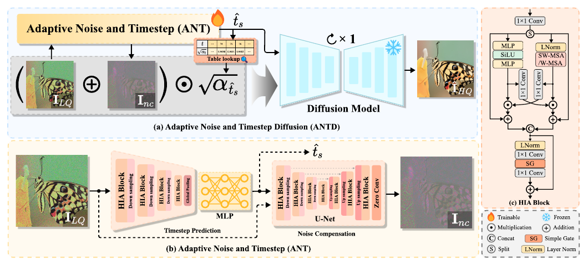

<div align="center">

# ANTD
### Adapting Pre-trained Diffusion Model for Blind Image Denoising<br>via Noise Compensation and Timestep Prediction

**ICIP 2026**

Kenan Zou · Qianjun Huang · Jiaqing Wang · Kai Zhang

School of Intelligence Science and Technology, Nanjing University

**[Paper](ICIP_ANT.pdf) · [Downloads](#downloads) · [Quick start](#quick-start) · [Training](#training) · [中文使用指南](docs/USAGE_zh-CN.md) · [Configuration](options/README.md)**

</div>

<p align="center">
  
</p>

**ANTD adapts a frozen diffusion prior to blind RGB image denoising.** A lightweight adaptive noise and timestep (ANT) branch predicts a noise compensation map and a diffusion timestep. The compensated input is restored with a single diffusion denoising step.

- **5.6M trainable parameters:** only the ANT branch is optimized; the 552.8M-parameter diffusion backbone stays frozen.
- **Blind inference:** no ground-truth noise level is supplied to the model.
- **Synthetic and real noise:** separate ANT checkpoints for Gaussian denoising and SIDD RGB denoising.

## Contents

[Downloads](#downloads) · [Installation](#installation) · [Checkpoints](#checkpoints) · [Data preparation](#data-preparation) · [Evaluation](#evaluation) · [Results](#paper-results) · [Reproducibility](#reproducibility-and-limitations) · [Citation](#citation)

## Downloads

The **ANTD** shared folder contains the **model weights, SIDD RGB dataset, and test datasets**.

> **[Download from Baidu Netdisk / 百度网盘](https://pan.baidu.com/s/179xOEEyei7qjDZyawkMBfw?pwd=antd)**  
> **Access code / 提取码: `antd`**

After downloading and extracting the files, place the model weights in `model_zoo/` and organize the images as described in [Data preparation](#data-preparation). SIDD training pairs go under `datasets/SIDD_medium/`; SIDD validation pairs and Gaussian denoising benchmarks go under `testsets/`. You can also keep the files elsewhere and set the paths in the training options or evaluation arguments.

## Installation

Run all commands from the repository root. The reference environment used for the release checks is **Python 3.9, PyTorch 2.4.1, torchvision 0.19.1, CUDA 12.4, and an NVIDIA RTX 4090**. Linux is recommended for multi-GPU DDP; single-GPU entry points also run on Windows.

```bash
conda create -n antd python=3.9 -y
conda activate antd
python -m pip install torch==2.4.1 torchvision==0.19.1 --index-url https://download.pytorch.org/whl/cu124
python -m pip install -r requirements.txt
```

Choose the appropriate PyTorch wheel for your driver/platform using the [PyTorch installation instructions](https://pytorch.org/get-started/previous-versions/). Keep torch and torchvision versions compatible. CUDA is required by the training entry point; evaluation supports `--device cpu`, though the large diffusion backbone makes CPU inference slow.

Optional no-reference quality metrics:

```bash
python -m pip install -r requirements-iqa.txt
```

LPIPS may download AlexNet weights on first use. PyIQA may download separate weights for each requested metric; prepare their caches before running offline.

## Checkpoints

Both an ANT checkpoint and the frozen diffusion checkpoint are required. Download the weights from the [ANTD shared folder](#downloads) and place them at the paths below. File sizes and SHA-256 hashes are listed in [model_zoo/README.md](model_zoo/README.md).

| Component | Expected file | Role |
|:--|:--|:--|
| ANT, Gaussian denoising | `model_zoo/ANT_blind.pth` | Trained over σ ∈ [5, 250] |
| ANT, real RGB denoising | `model_zoo/ANT_sidd.pth` | Trained on SIDD-Medium |
| Frozen diffusion backbone | `model_zoo/256x256_diffusion_uncond.pt` | ImageNet unconditional 256×256 model |

The diffusion backbone is available from [OpenAI guided-diffusion](https://github.com/openai/guided-diffusion). Use its **256×256 unconditional** checkpoint; other resolutions or class-conditional checkpoints are incompatible.

## Quick start

After installing dependencies and preparing the checkpoints and clean CBSD68 images:

```bash
python main_test_antd_blind_denoising.py --testset_name cbsd68 --noise_level_img 50 --device cuda
```

The script creates `results/antd_denoising/cbsd68_ANT_blind_50/` containing restored PNGs and a per-image/average PSNR, SSIM and LPIPS log.

For aligned SIDD validation RGB PNG pairs:

```bash
python main_test_antd_sidd_rgb.py --L_path testsets/sidd_validation/noisy --H_path testsets/sidd_validation/gt --device cuda
```

Results are written to `results/sidd_ANT_sidd/`.

## Data preparation

The SIDD RGB dataset and test datasets are available in the [ANTD shared folder](#downloads). Arrange the downloaded files according to the layout below. Original dataset sources are also listed for reference.

```text
ANTD/
├── ICIP_ANT.pdf
├── main_train_antd.py
├── main_test_antd_blind_denoising.py
├── main_test_antd_sidd_rgb.py
├── test_avg_iqa.py
├── options/                         # Annotated training configurations
├── data/                            # Dataset loaders
├── models/                          # ANT, diffusion backbone, training wrapper
├── utils/
├── model_zoo/                       # Place separately downloaded checkpoints here
├── datasets/                        # Local training data (not committed)
│   ├── clean_train/                 # Waterloo Exploration + DIV2K + Flickr2K
│   └── SIDD_medium/
│       ├── noisy/
│       └── gt/
├── testsets/
│   ├── cbsd68/
│   ├── ...
│   └── sidd_validation/
│       ├── noisy/
│       └── gt/
└── experiments/                     # Created by training
```

**Gaussian training.** Place clean RGB images from [Waterloo Exploration](https://ece.uwaterloo.ca/~k29ma/exploration/), [DIV2K](https://data.vision.ee.ethz.ch/cvl/DIV2K/) and [Flickr2K](https://github.com/LimBee/NTIRE2017) under `datasets/clean_train/`, optionally in subfolders. Noise is synthesized during loading. Training and evaluation splits must remain separate.

**Gaussian evaluation.** Use clean RGB images from CBSD68, [Kodak24](https://r0k.us/graphics/kodak/), McMaster and Urban100. The evaluation script adds AWGN itself. Do not pass an already noisy image folder to this script.

**SIDD.** Obtain [SIDD-Medium and SIDD validation](https://www.eecs.yorku.ca/~kamel/sidd/). Prepare aligned 8-bit sRGB image pairs under separate noisy/GT roots. The loader accepts identical relative filenames or official SIDD name pairs, e.g.:

```text
noisy/ValidationNoisyBlocksSrgb_0001_01.png
gt/ValidationGtBlocksSrgb_0001_01.png
```

## Evaluation

### Blind Gaussian denoising

```bash
python main_test_antd_blind_denoising.py --model_name ANT_blind --model_zoo model_zoo --diff_path model_zoo/256x256_diffusion_uncond.pt --testsets testsets --testset_name kodak24 --noise_level_img 100 --noise_seed 0 --device cuda --results results/antd_denoising
```

Paper noise levels are **15, 25, 50, 100, 150, 200**. Repeat the command for each dataset/noise level. `--noise_level_img` controls synthetic corruption only; ANT predicts its own timestep.

### Real RGB denoising

```bash
python main_test_antd_sidd_rgb.py --model_name ANT_sidd --model_zoo model_zoo --diff_path model_zoo/256x256_diffusion_uncond.pt --L_path testsets/sidd_validation/noisy --H_path testsets/sidd_validation/gt --results results --device cuda
```

This entry point evaluates paired RGB images. It requires aligned GT to report full-reference metrics.

### Optional no-reference quality assessment

```bash
python test_avg_iqa.py --image_folder results/sidd_ANT_sidd --metrics maniqa clipiqa musiq --device cuda
```

The folder is searched recursively. Keep only restored images in it. The script prints the number of successfully scored images for each metric; compare dataset averages only when every image was scored.

### Evaluation protocol

| Setting | Behavior in this release |
|:--|:--|
| Input/output | RGB; input mapped to [-1, 1] internally; restoration clamped and quantized to uint8 |
| Gaussian noise | NumPy RandomState reset to `noise_seed=0` for each image; σ divided by 255; noisy input **not clipped** |
| Spatial handling | Full-image inference, reflection padding to multiples of 64, then cropping to original size |
| PSNR / SSIM | RGB uint8 values, no border shaving; SSIM uses the repository's 11×11 Gaussian-window implementation |
| LPIPS | AlexNet, restored/GT uint8 images mapped to [-1, 1] |
| Output | Lossless PNG; input-relative subfolders preserved |
| Averaging | Arithmetic mean of per-image scores |

Inputs must be at least **64×64**. The scripts provide no tiling, x8 ensemble, or timestep scaling. The old `--x8`, `--t_factor` and `--need_degradation` flags were unused or misleading and have been removed. Run an entry point with `--help` for its supported arguments.

## Training

Edit one of the annotated option files:

| Task | Configuration |
|:--|:--|
| Blind Gaussian denoising | [options/train_ant_blind_denoising.json](options/train_ant_blind_denoising.json) |
| SIDD RGB denoising | [options/train_ant_sidd_HL.json](options/train_ant_sidd_HL.json) |

At minimum, set `gpu_ids`, data directories, `pre_trained.pre_trained_diff_path`, and a unique `task` name. The files are **JSON with `//` comments**, read by `utils/utils_option.py`; they are not strict JSON. Use forward slashes for paths, including on Windows. See the [configuration reference](options/README.md) for every setting.

```bash
python main_train_antd.py --opt options/train_ant_blind_denoising.json
python main_train_antd.py --opt options/train_ant_sidd_HL.json
```

Run these as separate experiments. For that batch/device setup, set `gpu_ids: [0, 1]` and `dataloader_batch_size: 4` in the selected configuration. Then use either a single process with DataParallel or, on Linux, DDP:

Only ANT is optimized. **Do not put the frozen diffusion forward pass inside `torch.no_grad()` during training**: reconstruction gradients must pass through the backbone to ANT.

### Checkpoints, resume and fine-tuning

Training writes to `experiments/<task>/`:

- `models/<iteration>_G.pth`: ANT weights, directly usable by evaluation.
- `models/<iteration>_optimizerG.pth`: Adam state when `G_optimizer_reuse=true`.
- `images/`: validation restorations; `options/`: resolved configuration snapshots.
- `train.log`: settings, losses and validation PSNR.

`auto_resume=true` loads the latest numbered ANT checkpoint and its matching optimizer state. Training stops at `total_iter` and saves the final checkpoint. For a fresh run, choose a new task name. For fine-tuning, also set `auto_resume=false`, set `path.pretrained_netG`, and leave `path.pretrained_optimizerG=null`.

Evaluate a training checkpoint without renaming it:

```bash
python main_test_antd_blind_denoising.py --model_zoo experiments/antd_blind_denoising/models --model_name 600000_G --testset_name cbsd68 --noise_level_img 50
```

## Paper results

The following values are transcribed from Tables 1 and 2 of the paper; they are **paper-reported results, not a new benchmark run**.

| Dataset | Noise | PSNR ↑ | SSIM ↑ | LPIPS ↓ |
|:--|:--:|--:|--:|--:|
| CBSD68 | σ=50 | 28.71 | 0.8164 | 0.1622 |
| Kodak24 | σ=50 | 30.12 | 0.8264 | 0.1698 |
| McMaster | σ=50 | 30.48 | 0.8551 | 0.1256 |
| Urban100 | σ=50 | 30.28 | 0.8935 | 0.0818 |
| SIDD validation RGB | Real | 39.37 | 0.9164 | 0.2145 |

For SIDD, the paper additionally reports MANIQA **0.2951**, CLIPIQA **0.2955**, and MUSIQ **22.55**. See the paper for the complete noise-level sweep, comparisons and ablations.


## Citation

```bibtex
@inproceedings{zou2026antd,
  title     = {Adapting Pre-trained Diffusion Model for Blind Image Denoising via Noise Compensation and Timestep Prediction},
  author    = {Zou, Kenan and Huang, Qianjun and Wang, Jiaqing and Zhang, Kai},
  booktitle = {IEEE International Conference on Image Processing (ICIP)},
  year      = {2026}
}
```

## Acknowledgements and license

This implementation builds on [KAIR](https://github.com/cszn/KAIR), [SCUNet](https://github.com/cszn/SCUNet), and [guided-diffusion].

